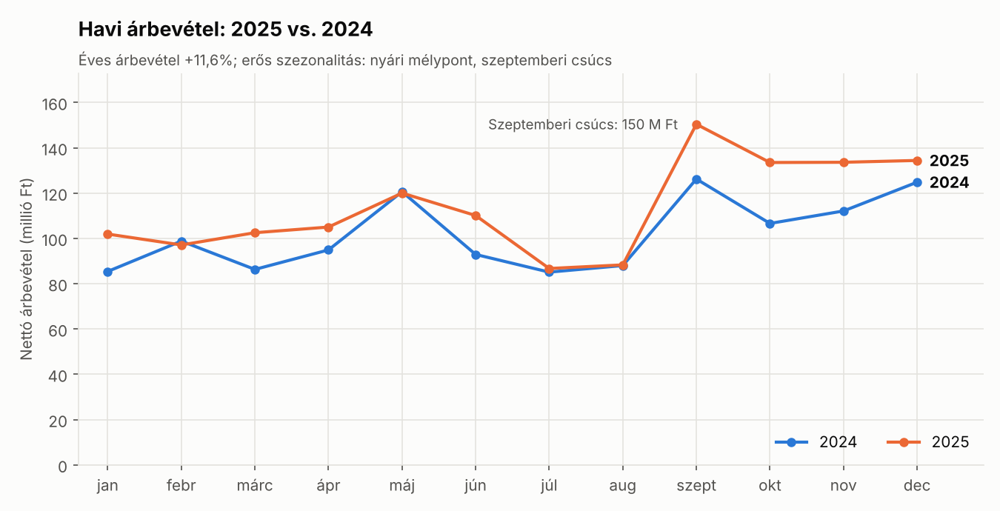
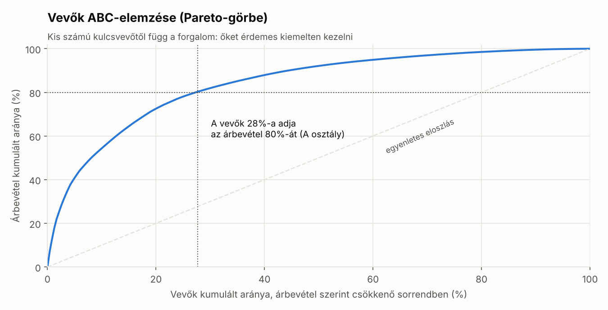
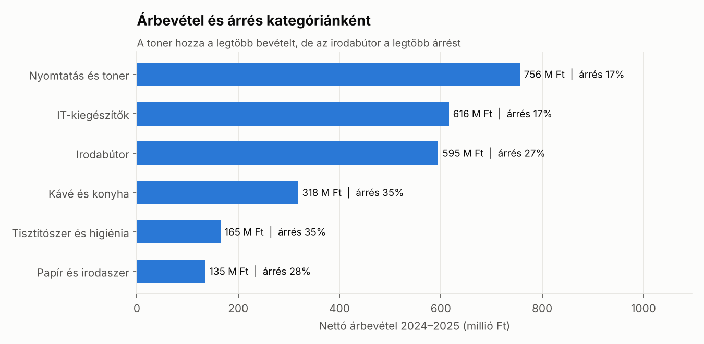
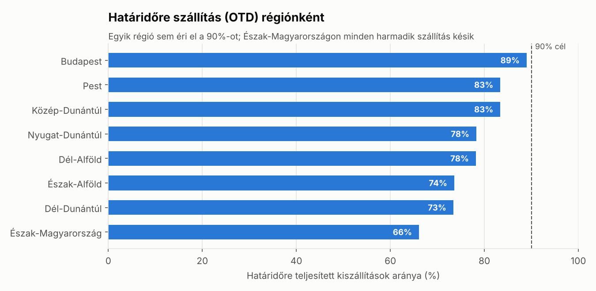

# Értékesítési elemzés SQL-lel és Power BI-jal (order-to-cash)

Egy fiktív irodaszer-nagykereskedő, a **Pannon Office Supply Kft.** két évnyi (2024–2025) értékesítési adatának elemzése: a vevői rendeléstől a kiszállításon és a számlázáson át a pénz beérkezéséig (order-to-cash). A projekt egy SAP SD-szerű értékesítési folyamatot modellez, és üzleti kérdésekre ad választ SQL-lel, a Power BI riport felépítését pedig külön útmutató írja le.

> **English summary:** End-to-end sales analysis of a fictional Hungarian office-supply wholesaler (2024–2025) covering the full order-to-cash process: sales orders, deliveries, invoices and payments. A Python script generates a reproducible synthetic dataset, a SQLite database is built from a relational schema, and 9 SQL queries (CTEs, window functions such as `LAG`, `RANK`, `ROW_NUMBER` and running totals) answer business questions on revenue trends, customer ABC analysis, category margins, on-time delivery and payment behaviour. A Power BI guide documents the star schema and DAX measures.

## Fő megállapítások

| Kérdés | Eredmény |
|---|---|
| Hogyan nőtt az árbevétel? | 1 221,7 → 1 363,5 millió Ft, **+11,6%**, változatlan 23,3%-os árréssel |
| Mennyire koncentrált a vevőkör? | A vevők **28%-a** (66 vevő) adja az árbevétel **80%-át** |
| Melyik kategória a legjövedelmezőbb? | A toner hozza a legtöbb bevételt (29%), de csak 17%-os árréssel; az **irodabútor** termeli a legtöbb árrést (160,6 millió Ft) |
| Időben szállítunk? | A határidőre szállítás aránya Budapesten 89%, **Észak-Magyarországon csak 66%** – egyik régió sem éri el a 90%-os célt |
| Hogyan fizetnek a vevők? | A közszféra számláinak **85%-a késve** érkezik; a nagyvállalatok a leghosszabb, 45 napos határidővel fizetnek |
| Mekkora a nyitott követelés év végén? | 310 számla, 181,3 millió Ft – ennek 93%-a még nem lejárt |









## Javaslatok az elemzés alapján

1. **Kulcsvevő-kezelés:** az A osztályú 66 vevő elvesztése a forgalom jelentős részét veszélyeztetné, ezért nekik dedikált kapcsolattartó és éves keretszerződés javasolt.
2. **Árazás a toner kategóriában:** a legnagyobb bevételű kategória árrése a legalacsonyabb; a beszerzési feltételek újratárgyalása itt hozná a legtöbbet.
3. **Logisztika vidéken:** Észak-Magyarországon és a Dél-Dunántúlon a tervezett átfutási idő vagy a szállítópartner felülvizsgálata indokolt.
4. **Követeléskezelés:** a közszféra számláinál automatikus fizetési emlékeztető a határidő előtt 5 nappal.

## Az adatmodell

Hat tábla, a valós ERP-rendszerek (pl. SAP SD) értékesítési folyamatát követve:

```
customers ──< sales_orders >── order_items >── products
                   │
                   ├── deliveries   (kiszállítás: tervezett és tényleges dátum)
                   └── invoices     (számla: határidő és fizetési dátum)
```

| Tábla | Sorok | Tartalom |
|---|---|---|
| `customers` | 250 | vevőtörzs: szegmens, régió, fizetési határidő |
| `products` | 60 | termékek 6 kategóriában, lista- és beszerzési árral |
| `sales_orders` | 5 200 | rendelésfejek: dátum, értékesítési csatorna, státusz |
| `order_items` | 17 827 | rendelési tételek: mennyiség, ár, kedvezmény |
| `deliveries` | 5 026 | kiszállítások |
| `invoices` | 5 026 | számlák és kifizetések |

## SQL-elemzések

| Fájl | Üzleti kérdés | SQL-technika |
|---|---|---|
| [`01_schema.sql`](sql/01_schema.sql) | Adatbázisséma | elsődleges és idegen kulcsok, `CHECK`, indexek |
| [`02_views.sql`](sql/02_views.sql) | Közös elemzési nézet | többtáblás `JOIN`, számított mezők |
| [`03_data_quality.sql`](sql/03_data_quality.sql) | Megbízhatók az adatok? | `LEFT JOIN … IS NULL`, `NOT EXISTS`, `UNION ALL` |
| [`04_kpi_overview.sql`](sql/04_kpi_overview.sql) | Fő mutatók évenként | CTE, `LAG` |
| [`05_monthly_trend.sql`](sql/05_monthly_trend.sql) | Havi trend, YoY változás | `LAG(…, 12)`, kumulált összeg `PARTITION BY`-jal |
| [`06_customer_abc.sql`](sql/06_customer_abc.sql) | Vevők ABC-elemzése | kumulált részarány ablakfüggvénnyel, `CASE` |
| [`07_category_margin.sql`](sql/07_category_margin.sql) | Kategóriák jövedelmezősége | `RANK`, részesedés `SUM() OVER ()`-rel |
| [`08_top_products.sql`](sql/08_top_products.sql) | Top 3 termék kategóriánként | `ROW_NUMBER() OVER (PARTITION BY …)` |
| [`09_delivery_performance.sql`](sql/09_delivery_performance.sql) | Határidőre szállítás régiónként | dátumkülönbség, feltételes átlag |
| [`10_payment_behaviour.sql`](sql/10_payment_behaviour.sql) | Fizetési fegyelem szegmensenként | értékkel súlyozott átlag |
| [`11_receivables_aging.sql`](sql/11_receivables_aging.sql) | Nyitott követelések korosítása | korosítási sávok `CASE`-szel |

Az összes lekérdezés eredménye megtalálható a [`results/`](results) mappában CSV-ként.

## Power BI

A [`powerbi/README.md`](powerbi/README.md) leírja a riport felépítését: a csillagsémát, a dátumtáblát, a DAX-mértékeket (pl. `Revenue YoY %`, `On-Time Delivery %`, `Late Payment %`) és a három riportoldalt.

## Futtatás

Python 3.10+ szükséges.

```bash
git clone https://github.com/illesflorian55-prog/sales-analysis-sql-powerbi.git
cd sales-analysis-sql-powerbi
pip install -r requirements.txt

python data/generate_data.py   # adatkészlet generálása -> data/raw/
python src/run_analysis.py     # adatbázis felépítése és SQL-elemzések -> results/
python src/make_charts.py      # diagramok -> images/
```

## Projektstruktúra

```
├── data/
│   ├── generate_data.py   # szintetikus adatkészlet generálása
│   └── raw/               # nyers CSV-k (Power BI-ba is ezek töltődnek be)
├── sql/                   # séma, nézet és elemző lekérdezések
├── src/
│   ├── run_analysis.py    # adatbázis felépítése, lekérdezések futtatása
│   └── make_charts.py     # diagramok a README-hez
├── results/               # a lekérdezések eredményei CSV-ben
├── images/                # diagramok
└── powerbi/               # Power BI riport útmutató
```

## Az adatokról

Az adatkészlet **szintetikus**: rögzített véletlenmaggal generált, így bárki pontosan ugyanazokat az eredményeket kapja. A cég, a vevők és a számok kitaláltak, de a generátor valószerű üzleti mintázatokat épít bele: szezonalitást (nyári mélypont, szeptemberi iskolakezdési csúcs), kb. 12%-os éves növekedést, Pareto-eloszlású vevőkört, régiónként eltérő szállítási teljesítményt és szegmensenként eltérő fizetési fegyelmet.

## Szerző

Illés Flórián – gazdaságinformatikus BSc hallgató, Miskolci Egyetem

## Licenc

MIT licenc, a részletek a [LICENSE](LICENSE) fájlban olvashatók.
