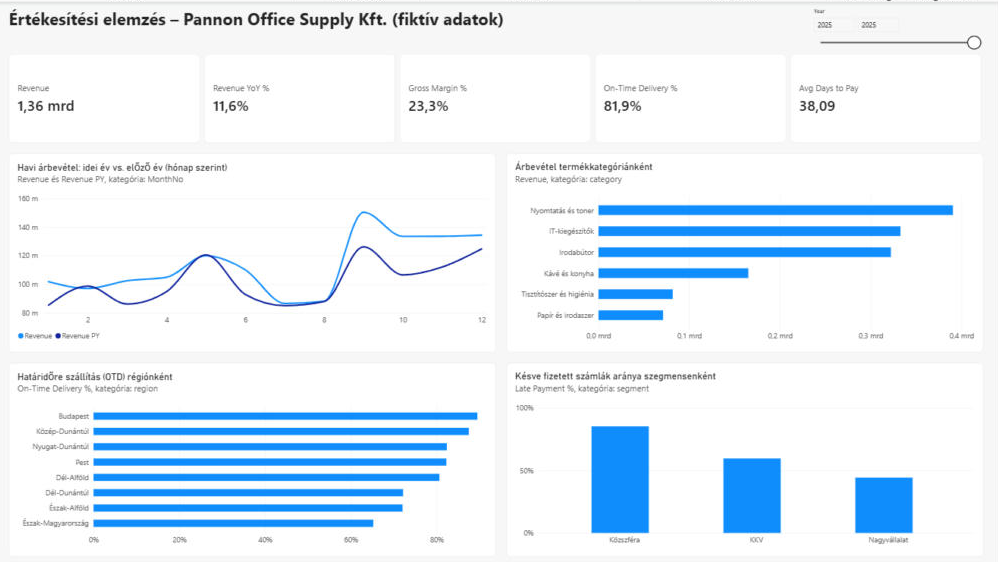

# Power BI riport

A [`sales_analysis_powerbi.pbix`](sales_analysis_powerbi.pbix) Power BI Desktopban megnyitható riport. Az adatokat közvetlenül ebből a GitHub-repóból tölti be, így a **Frissítés** gombbal bárhol, külön letöltés nélkül újratölthető.



## A riport tartalma

Egy áttekintő oldal, évválasztóval (alapértelmezés: 2025):

| Elem | Mit mutat |
|---|---|
| KPI-kártyák | Árbevétel, éves változás, árrés %, határidőre szállítás %, átlagos fizetési idő (nap) |
| Vonaldiagram | Havi árbevétel a kiválasztott évben és az előző évben |
| Sávdiagram | Árbevétel termékkategóriánként |
| Sávdiagram | Határidőre szállítás aránya régiónként |
| Oszlopdiagram | Késve fizetett számlák aránya vevőszegmensenként |

A diagramok szűrik egymást: egy kategóriára vagy szegmensre kattintva az egész oldal arra szűkül.

## 1. Adatbetöltés (Power Query)

Mind a hat tábla a GitHub raw URL-jéről töltődik be. Példa a `customers` táblára:

```m
let
    Source = Csv.Document(
        Web.Contents("https://raw.githubusercontent.com/illesflorian55-prog/sales-analysis-sql-powerbi/main/data/raw/customers.csv"),
        [Delimiter = ",", Encoding = 65001, QuoteStyle = QuoteStyle.Csv]),
    Promoted = Table.PromoteHeaders(Source, [PromoteAllScalars = true]),
    Typed = Table.TransformColumnTypes(Promoted, {
        {"customer_id", type text}, {"customer_name", type text}, {"segment", type text},
        {"region", type text}, {"payment_terms_days", Int64.Type}, {"customer_since", type date}}, "en-US")
in
    Typed
```

Power Queryben számított oszlopok:

| Tábla | Oszlop | Képlet |
|---|---|---|
| `order_items` | `net_revenue` | mennyiség × egységár × (1 − kedvezmény) |
| `order_items` | `line_cost` | mennyiség × beszerzési ár |
| `deliveries` | `on_time` | 1, ha a tényleges szállítás nem később, mint a tervezett |
| `invoices` | `days_to_pay` | a számla és a kifizetés között eltelt napok |
| `invoices` | `paid_late` | 1, ha a fizetés a határidő után történt |

A `invoices` táblában az üres `payment_date` értékek `null`-ra cserélődnek (nyitott számlák).

## 2. Adatmodell

```
customers 1 ──< * sales_orders 1 ──< * order_items >── * 1 products
                       │ 1   ▲ *
                       │     └── 1 Date
            ┌──────────┴──────────┐
         1 deliveries         1 invoices
```

| Innen (*) | Ide (1) | Kulcs |
|---|---|---|
| `sales_orders` | `customers` | `customer_id` |
| `order_items` | `sales_orders` | `order_id` |
| `order_items` | `products` | `product_id` |
| `deliveries` | `sales_orders` | `order_id` (1:1) |
| `invoices` | `sales_orders` | `order_id` (1:1) |
| `sales_orders` | `Date` | `order_date` → `Date` |

Dátumtábla (DAX):

```dax
Date = ADDCOLUMNS(
    CALENDAR(DATE(2024, 1, 1), DATE(2025, 12, 31)),
    "Year", YEAR([Date]),
    "MonthNo", MONTH([Date]),
    "Month", FORMAT([Date], "yyyy-mm"),
    "Quarter", "Q" & QUARTER([Date])
)
```

## 3. DAX-mértékek

```dax
Revenue = CALCULATE(SUM(order_items[net_revenue]), sales_orders[status] = "Teljesített")

Gross Margin = [Revenue] - CALCULATE(SUM(order_items[line_cost]), sales_orders[status] = "Teljesített")

Gross Margin % = DIVIDE([Gross Margin], [Revenue])

Orders = CALCULATE(DISTINCTCOUNT(sales_orders[order_id]), sales_orders[status] = "Teljesített")

Average Order Value = DIVIDE([Revenue], [Orders])

Revenue PY = CALCULATE([Revenue], SAMEPERIODLASTYEAR('Date'[Date]))

Revenue YoY % = DIVIDE([Revenue] - [Revenue PY], [Revenue PY])

On-Time Delivery % = AVERAGE(deliveries[on_time])

Late Payment % = AVERAGE(invoices[paid_late])

Avg Days to Pay = AVERAGE(invoices[days_to_pay])
```

## Ellenőrzés az SQL-eredményekkel

A riport 2025-re ugyanazt adja, mint az SQL-elemzés ([`results/04_kpi_overview.csv`](../results/04_kpi_overview.csv)): **1 363,5 millió Ft árbevétel, +11,6% éves növekedés, 23,3% árrés**.
